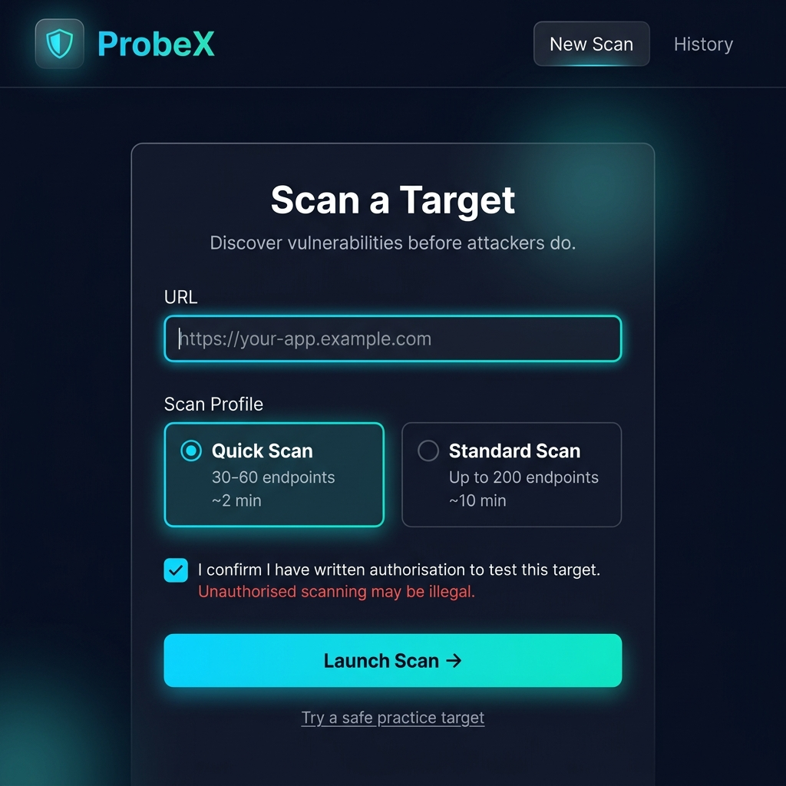
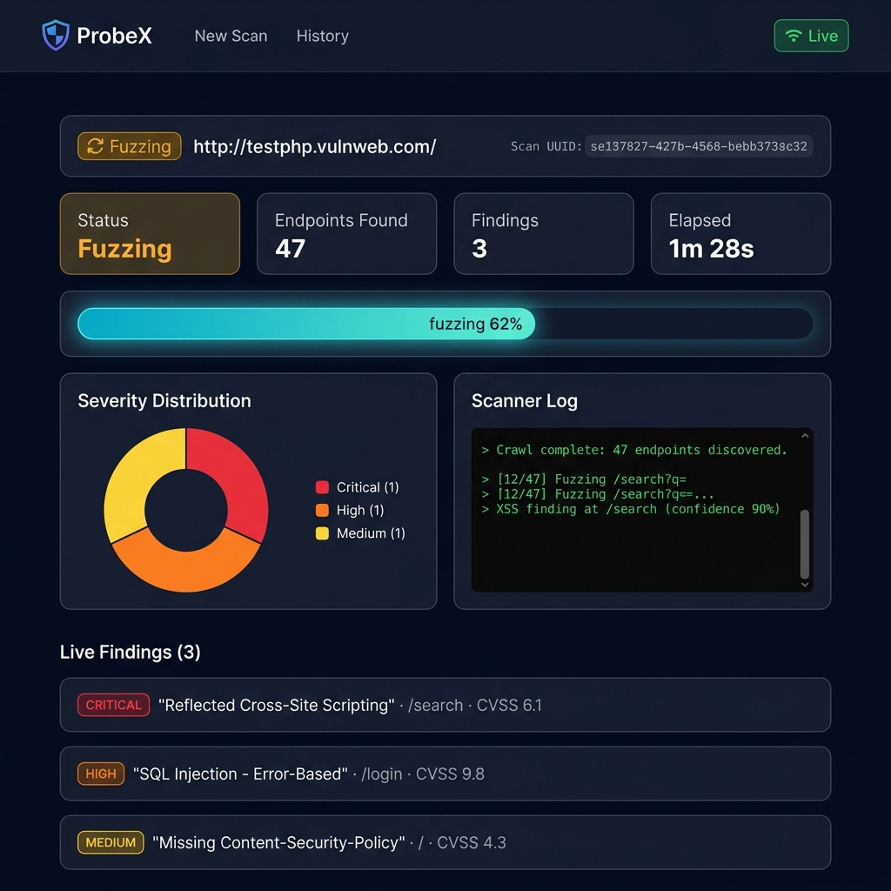

# ProbeX

> **This is a scoped-down solo prototype ahead of a full 4-person team build.
> See the [full build plan](docs/01-ProbeX-Build-Prompts.md) for the complete
> architecture and multi-sprint roadmap.**

ProbeX is a browser-based **Dynamic Application Security Testing (DAST)** scanner
that runs entirely on localhost with zero external services besides an optional
Gemini API key.  It crawls a target web application, fuzzes every discovered
endpoint with curated payloads, scores confidence using a baseline-aware false-positive
filter, and generates context-aware AI remediation — all surfaced in a React
frontend over WebSockets in real time.

---

## Screenshots

### Scan launcher



*Target URL field, Quick / Standard profile cards, the required consent gate,
and the "Try a safe practice target" shortcut.*

### Live scan dashboard



*Real-time progress bar, scrolling scanner log, and the findings feed animating
in as vulnerabilities are detected.*

---

## Running locally (two terminals)

### Prerequisites

| Tool | Version |
|---|---|
| Python | 3.11 + |
| Node.js | 18 + |
| npm | 9 + |
| (Optional) [Gemini API key](https://aistudio.google.com/) | — |

---

### Terminal 1 — Backend (FastAPI + SQLite)

```bash
# From repo root
cd backend

# Create and activate a virtual environment
python -m venv .venv

# Windows PowerShell
.venv\Scripts\Activate.ps1
# macOS / Linux
# source .venv/bin/activate

pip install -r requirements.txt

# (Optional) set your Gemini key for AI-powered remediation
# Copy the example env and edit it:
copy ..\.env.example .env          # Windows
# cp ../.env.example .env          # macOS / Linux
# Then set GEMINI_API_KEY=<your key>
# Leave blank to use the curated offline fallback — zero API calls needed.

# Start the API server
uvicorn app.main:app --reload
# → http://localhost:8000
# → http://localhost:8000/docs  (interactive OpenAPI UI)

# (Optional) seed the example scan — run from inside backend/
python ../seed/seed_example_scan.py
```

### Terminal 2 — Frontend (Vite + React)

```bash
# From repo root
cd frontend

npm install          # first time only
npm run dev
# → http://localhost:5173
```

Open **http://localhost:5173** in your browser.  The frontend talks to the backend
at `http://localhost:8000` by default (configured in `frontend/.env`).

---

### Quick smoke-test

```bash
# Check the backend is alive
curl http://localhost:8000/api/health
# {"status":"ok"}

# List scans (empty on a fresh DB)
curl http://localhost:8000/api/scans
# []
```

---

## How it works

```
Browser (React) ──POST /api/scans──► FastAPI ──► asyncio task
                                                      │
                ◄──WS /ws/scans/{id}─────────────────┘
                   (live findings, log lines, progress)

FastAPI pipeline:
  queued → crawling → fuzzing → analyzing (AI) → done
               │           │
         BFS crawler   XSS / SQLi / Headers detectors
         (httpx)       (confidence.py baseline filter)
```

The **confidence module** is the core false-positive defence: a pattern match
only counts if it was *not already present* in the baseline response (e.g. a
page whose footer already contains the word "error" is never wrongly flagged as
SQL Injection).

---

## Project structure

```
probex/
├── backend/
│   ├── app/                     # FastAPI application
│   │   ├── main.py              # App factory, CORS, lifespan
│   │   ├── schemas.py           # Pydantic v2 request / response models
│   │   ├── api/
│   │   │   ├── scans.py         # REST: POST/GET /api/scans
│   │   │   └── ws.py            # WebSocket: /ws/scans/{id}
│   │   ├── core/
│   │   │   ├── config.py        # pydantic-settings env loader
│   │   │   └── runner.py        # Scan orchestrator (4-stage pipeline)
│   │   └── db/
│   │       ├── models.py        # SQLModel ORM tables (ScanRow, FindingRow)
│   │       ├── session.py       # SQLite engine + session factory
│   │       └── crud.py          # CRUD helpers
│   ├── engine/                  # Standalone DAST engine (zero FastAPI imports)
│   │   ├── confidence.py        # Baseline-aware false-positive filter ← key IP
│   │   ├── crawler.py           # Async BFS web crawler
│   │   ├── fuzzer.py            # Payload injection engine
│   │   └── detectors/           # XSS, SQLi, security-headers detectors
│   ├── ai/
│   │   ├── prompts.py           # Gemini prompt builder (4-section format)
│   │   ├── remediation.py       # Async Gemini call + 5s timeout
│   │   └── offline_fallback.py  # Template-keyed static fallback (9 vulns)
│   ├── templates/payloads/      # YAML payload libraries
│   ├── seed/
│   │   └── seed_example_scan.py # Inserts 11-finding demo scan (is_example=true)
│   └── tests/                   # 132 tests — confidence, detectors, API, AI
├── frontend/
│   ├── src/
│   │   ├── api/
│   │   │   ├── client.ts        # Typed fetch wrapper (VITE_API_URL)
│   │   │   └── socket.ts        # useScanSocket() — WS hook with backoff
│   │   ├── pages/
│   │   │   ├── NewScan.tsx      # Scan launcher form
│   │   │   ├── ScanDetail.tsx   # Live dashboard + findings explorer
│   │   │   └── ScanHistory.tsx  # History list with example-scan badge
│   │   └── styles/tokens.css    # Design tokens (synced with reporter.py)
│   └── package.json
├── .env.example
└── README.md
```

---

## API reference

| Method | Path | Description |
|--------|------|-------------|
| `GET`  | `/api/health` | Liveness probe → `{"status":"ok"}` |
| `POST` | `/api/scans`  | Start a scan; body requires `consent_confirmed: true` |
| `GET`  | `/api/scans`  | List all scans (newest first) |
| `GET`  | `/api/scans/{id}` | Full scan + all findings |
| `GET`  | `/api/scans/{id}/report?format=json\|html` | Downloadable report |
| `WS`   | `/ws/scans/{id}` | Real-time event stream |

---

## Consent requirement

Every `POST /api/scans` must include `"consent_confirmed": true`.
Requests with `false` are rejected with HTTP 400.

**Only scan applications you own or have explicit written authorisation to test.
Unauthorised scanning may be illegal in your jurisdiction.**

---

## Test suite

```bash
cd backend
python -m pytest tests/ -q
# 132 passed
```

Coverage spans: confidence false-positive logic, XSS/SQLi/headers detectors,
API endpoints (consent gate, 404 handling, report formats), and the AI layer
(prompt structure, offline fallback for every template, timeout / error safety).

---

## Prototype scope

This repository is a **scoped-down solo prototype** that implements the core
engine, API, and frontend for evaluation purposes.  It intentionally excludes:

- Multi-user auth and session management
- A persistent cloud database (currently SQLite on localhost)
- The full payload library (20+ detector templates planned)
- A YAML plugin system for custom detectors
- Rate limiting, IP-based consent enforcement, and audit logging

All of the above are designed and documented in the
[full build plan](docs/01-ProbeX-Build-Prompts.md), which will be added to the
team repository when the 4-person build phase begins.
